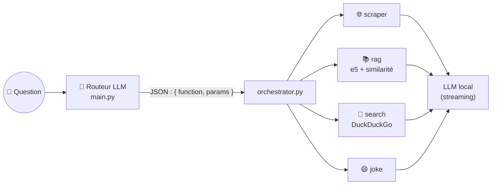

<h1 align="center">🕸️ Agent-Ai</h1>

<p align="center">
  <strong>Un orchestrateur multi-agents en ligne de commande : un LLM local lit votre question<br/>
  et l'envoie au bon agent (lecture de page web, RAG sur PDF, recherche web, blague).</strong>
</p>

<p align="center">
  
  
  
  
  
</p>

---

C'est mon premier pas vers les agents : comprendre comment un LLM peut **choisir un outil** plutôt que de tout
faire lui-même. Le principe a ensuite été repris et poussé beaucoup plus loin dans
[JobMatch Agent](https://github.com/DHoudetot-Cyril/jobmatch-agent).

## ✨ Les agents

| Agent | Quand ? | Ce qu'il fait |
|---|---|---|
| 🌐 `scraper` | la question contient une URL | télécharge la page (`requests` + BeautifulSoup) et la résume |
| 📚 `rag` | la réponse doit venir des documents internes | cherche les passages proches dans les PDF de `source/` et répond à partir d'eux |
| 🔎 `search` | question générale | recherche DuckDuckGo puis synthèse |
| 😄 `joke` | le mot « blague » apparaît | raconte une blague courte sur le thème demandé |

Exemples :

```text
>> Résume cette page https://fr.wikipedia.org/wiki/Jeanne_d%27Arc        → scraper
>> Selon les documents internes, quelles sont les conclusions du rapport ? → rag
>> Fais-moi une blague sur les développeurs                                → joke
```

## 🧠 Comment ça marche



1. Le LLM reçoit la question et un prompt système qui l'oblige à répondre **uniquement en JSON**.
2. `main.py` extrait ce JSON, puis `orchestrator.py` appelle l'agent indiqué.
3. L'agent récupère son contexte (page, passages de PDF, résultats de recherche) et redemande au LLM une réponse en français.

## 🚀 Démarrage rapide

### Prérequis

- Python 3.10+
- Un serveur LLM **compatible OpenAI** : llama.cpp, Ollama, LM Studio, vLLM…

### Installation

```bash
git clone https://github.com/DHoudetot-Cyril/Agent-Ai.git
cd Agent-Ai
python -m venv .venv && source .venv/bin/activate
pip install -r requirements.txt
mkdir source          # déposez-y vos PDF pour l'agent RAG
```

### Lancer un LLM local (exemple avec llama.cpp)

```bash
./llama-server -m /chemin/vers/modele.gguf -c 4096 --host 127.0.0.1 --port 8080
```

Puis ajustez `base_url` et `LLM_MODEL_NAME` dans [`utils/llm.py`](utils/llm.py) (avec Ollama :
`http://localhost:11434/v1`), et lancez :

```bash
python main.py
```

## 📁 Structure du projet

```text
Agent-Ai/
├── main.py              # boucle CLI + routage par le LLM
├── orchestrator.py      # appelle l'agent choisi
├── agents/
│   ├── scraper_agent.py # page web → résumé
│   ├── rag_agent.py     # RAG sur les PDF de source/
│   ├── rag_engine.py    # extraction PDF, embeddings, recherche
│   ├── search_agent.py  # DuckDuckGo → synthèse
│   └── joke_agent.py
└── utils/
    ├── llm.py           # client OpenAI-compatible (streaming)
    └── logger.py
```

## 🩹 Dépannage

| Problème | Solution |
|---|---|
| Erreur 401 / 404 du LLM | vérifiez `base_url` (souvent terminé par `/v1`) et le nom du modèle |
| « JSON invalide » | reformulez la question ; les petits modèles suivent moins bien le format |
| Aucun PDF trouvé | le dossier `source/` doit exister et contenir des `.pdf` lisibles |
| Erreur torch / GPU | installez la version de PyTorch adaptée (CUDA, ROCm ou CPU) |

## 🗺️ Pistes d'amélioration

- [ ] Lire la configuration du LLM depuis des variables d'environnement
- [ ] Remplacer le JSON « fait main » par le *tool calling* natif de l'API
- [ ] Découper les PDF en passages (*chunking*) et utiliser une base vectorielle
- [ ] Ajouter des tests avec un LLM factice

## 👤 Auteur

**Cyril D'Houdetot** · [GitHub](https://github.com/DHoudetot-Cyril)
